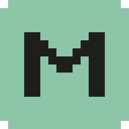

<p align="center"></p>

# MesoVibe [](https://github.com/danielfang7/MesoVibe/actions/workflows/ci.yml) [](https://github.com/danielfang7/MesoVibe/releases/latest)

MesoVibe is a free, open-source companion for MapleStory Classic World. It reads the game window the way a stream viewer sees it and shows your EXP per hour, time to level, the mesos you pick up, your sessions map by map and your chat, in a panel beside the game or a small overlay on it.

## Download

Get the installer from the [latest release](https://github.com/danielfang7/MesoVibe/releases/latest). It has everything MesoVibe needs, and MesoVibe updates itself after that.

- **macOS** 12.3 or later, Apple silicon: open `MesoVibe.dmg` and drag MesoVibe to Applications.
- **Windows** 10 (1903) or later: run `MesoVibe-Setup.exe`. It isn't code-signed yet, so Windows may warn first: choose "More info", then "Run anyway".

Every release lists its files' checksums in `SHA256SUMS`.

## Fair play

MesoVibe only looks at the game window, through the operating system's screen capture. It never sends input to the game, never reads or writes the game's memory or files, never injects code, and never touches its network traffic. Changes that would do any of these are not accepted.

MesoVibe is not affiliated with or endorsed by Nexon. MapleStory is a trademark of Nexon.

## Project layout

- [engine](engine/) - screen capture and the recognizers that read the game's EXP bar, chat, pickup notices and map name
- [app](app/) - the Tauri desktop app: windows, tray, settings, session storage and updates
- [ui](ui/) - the panel, the mini-HUD and the chat overlay
- [sdk](sdk/) - the plugin API, `@mesovibe/sdk`
- [plugins](plugins/) - first-party plugins, starting with the Session Tracker
- [tools](tools/) - capture helpers for developing recognizers, and the icon generator
- [scripts](scripts/) - build checks, tests and release scripts
- [web](web/) - the project website at mesovibe.com: static files with no build step, deployed by Vercel from `main` (the Vercel project's Root Directory is `web`; headers are in [web/vercel.json](web/vercel.json))

## Building from source

This is only needed to work on MesoVibe itself. You need Rust stable ([rustup](https://rustup.rs)), Node 24 and pnpm 12. On Windows, also the Visual Studio Build Tools with the C++ workload.

```sh
pnpm install
pnpm build
pnpm tauri dev
```

`pnpm tauri build` makes a release build. Releases are signed and published as described in [docs/RELEASING.md](docs/RELEASING.md).

### License

MesoVibe is licensed under the BSD 2-clause license. See [LICENSE](LICENSE).

## Contribute and develop

See [CONTRIBUTING.md](.github/CONTRIBUTING.md) for how to build, test and submit changes. To report a security issue, see [SECURITY.md](.github/SECURITY.md).
